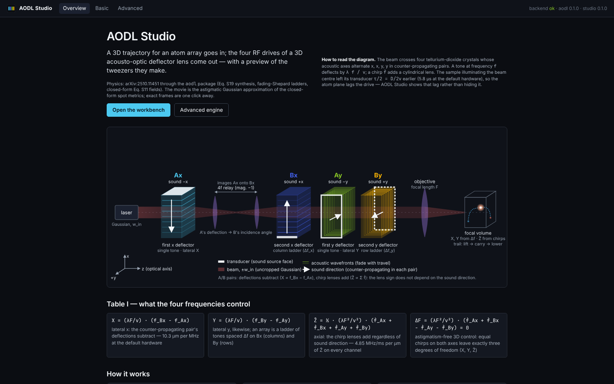
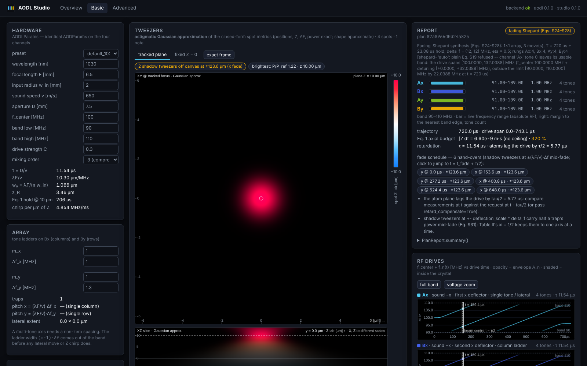
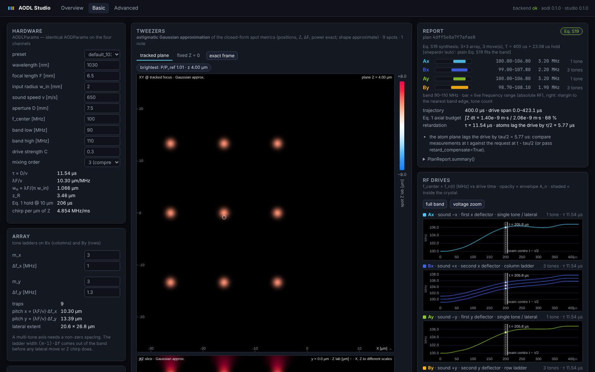
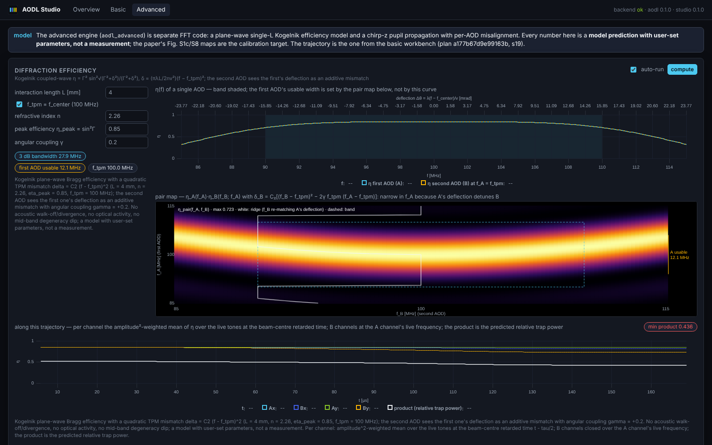
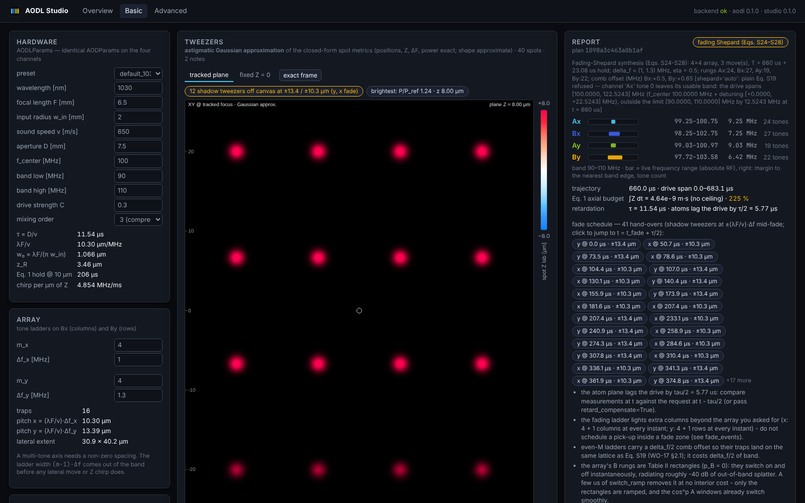
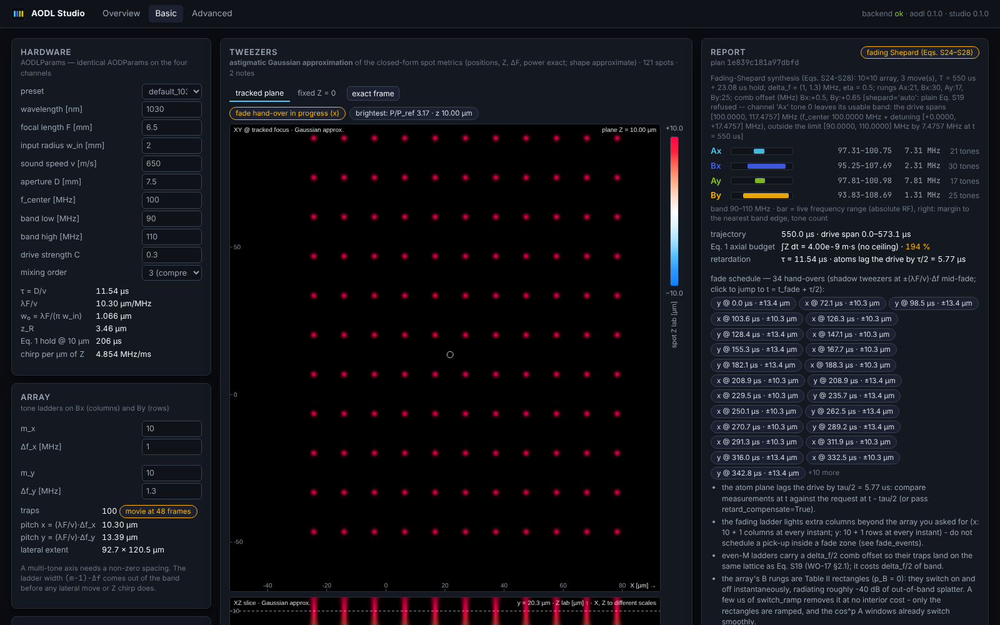

# AODL Studio

AODL Studio is a web workbench on top of the [`aodl`](../README.md) package. You describe a
3D motion of an optical-tweezer array — lift, carry, hold, or an arbitrary smooth `Path`
through waypoints — and the Studio hands back the four RF drive waveforms of a 3D
acousto-optic deflector lens (the four counter-propagating TeO₂ AODs of
[arXiv:2510.11451](https://arxiv.org/abs/2510.11451)), the plan report (`Eq. S19` or
fading-Shepard ladders, band usage, the Eq. 1 axial budget, the hand-over schedule), a
runnable Python script and the parametric NPZ, and a movie of the tweezers it makes. The
basic mode is a thin layer over `aodl`: `plan_motion` → `simulate` → `intensity_frame`; no
physics is re-derived in the web layer, and the generated script reproduces every plan with
plain `aodl`.

The page is built to show what an AOD does with time. The RF panel shades the drive segment
`[t − τ, t]` that currently sits inside each crystal and marks the beam-centre retarded time
`t − τ/2` that the atoms actually see; the acoustic-window panel draws the envelope and
instantaneous frequency across every aperture, with the unfilled region while the sound is
still travelling; the movie is the astigmatic-Gaussian approximation of the closed-form spot
metrics, with the exact `Eq. S11` frame one click away on the same colour scale; and the
shadow tweezers of a fading hand-over appear as their own spots at `±λF/v · Δf`. An
**advanced** mode runs a separate, FFT-based pupil engine (`aodl_advanced`) for Bragg
diffraction-efficiency roll-off, per-AOD misalignment, beat-averaged intensity and RF spectra.

## Screenshots

| | |
|---|---|
|  *Landing: the four-crystal setup and Table I.* |  *Basic: `single_lift_hold` at the first x hand-over + τ/2 — the badge reports the two shadow tweezers at ±123.6 µm.* |
|  *Basic: a 3×3 array on a 30°-tilted circular `Path`.* |  *Advanced: TPM Bragg efficiency, the A–B pair map with its ridge, and the efficiency along the trajectory.* |
|  *Basic: the 4×4 array on fading-Shepard ladders (order-1 movie metrics).* |  *Basic: the 10×10 flagship traverse mid-carry.* |

## Quick start

```bash
make -C webapp install     # pip install -e .[dev] -e webapp/backend[dev]; npm ci in webapp/frontend
make -C webapp dev         # API on http://localhost:8000 (/api, /docs), UI on http://localhost:5173
```

Open <http://localhost:5173>. The landing page links the seven starter examples
(`/basic?example=pick_and_place`, `…=single_lift_hold`, `…=array_lift_hold`,
`…=array_arbitrary_path`, `…=sphere_loop`, `…=square_xy`, `…=flagship_10x10`); the advanced
page takes the same trajectory (`/advanced?example=…`).

Single-server production path (the backend serves the built bundle at `/` with an SPA
fallback, so deep links survive a reload):

```bash
make -C webapp build && make -C webapp serve     # http://localhost:8000
```

`frontend/dist` is not checked in, so `make build` has to run before `make serve`.
`AODL_STUDIO_FRONTEND_DIST` overrides the bundle location; `AODL_STUDIO_STRICT_ADVANCED=1`
(set by `make test` and CI) turns a broken advanced-router import into a hard failure.

## Architecture

```
webapp/
  backend/src/aodl_webapp     FastAPI service: schemas (= API.md), planner, waveform IR,
                              spot clustering + simulate/frame routes, aperture content,
                              code generation, LRU caches keyed by plan_id
  backend/src/aodl_advanced   separate FFT pupil engine: TPM Bragg efficiency, misalignment,
                              chirp-z propagation, line decomposition of the beats, spectra
  frontend/src                Vite + React + TypeScript: pure-TS ports of the aodl evaluators
                              (physics/), zustand store, canvas panels, uPlot metrics
  scripts/                    gen_frontend_fixtures.py (golden JSON for the TS tests), e2e.mjs
  docs/                       DESIGN.md, API.md, VERIFICATION.md, work orders, reports
```

* The JSON contract is [`docs/API.md`](docs/API.md) (normative; the pydantic models in
  `aodl_webapp/schemas.py` *are* the document and `frontend/src/api/types.ts` mirrors it).
  The API is stateless: every route takes the full `PlanRequest`, identified by
  `plan_id = sha1(canonical JSON)[:16]`, and the server caches `MotionPlan` / `SimResult`
  by that id.
* The design and its physics rules are in [`docs/DESIGN.md`](docs/DESIGN.md): `aodl` is the
  physics authority of the basic mode; the movie is the astigmatic Gaussian beam approximation
  of `SpotMetrics` with one spot per *spatial cluster* of a frequency group; retardation is
  shown, not hidden; fade envelopes are evaluated from the parametric waveform IR the backend
  ships (nothing is re-sampled).
* The frontend's waveform evaluators (`piecewisePoly`, `envelope`, `waveform`, `aperture`)
  are tested against golden fixtures produced by the backend's own reference evaluator
  (`aodl_webapp.ir.evaluate_ir`), so the TypeScript port has a single source of truth.
* The verification run with the measured numbers is
  [`docs/VERIFICATION.md`](docs/VERIFICATION.md).

## Physics caveats (what the movie approximates)

The basic movie is **exact** for spot positions, best-focus Z, astigmatic interval and power
(all closed form, Table I of the paper; shadow tweezers appear as their own spots at the right
places with the right power) and **approximate** for the intensity *shape*: it ignores the
aperture fill edge (so the first `τ` after the drive starts looks like a dim Gaussian rather
than a truncated one), acoustic irising, and interference between co-located degenerate terms
(the simultaneous-fading Mach–Zehnder case). The *exact frame* button fetches the closed-form
`Eq. S11` frame to show the difference. A frame at observation time `t` is driven by the
waveform at `t − τ/2`, and a pair-driven tweezer is dark before `t = τ/2` — the movie shows
both. The movie metrics drop to mixing order 1 when a frame holds more than 160 frequency
groups (the 4×4 and 10×10 fading examples); the plan and report keep the requested order.

## Tests

```bash
make -C webapp test        # backend pytest (AODL_STUDIO_STRICT_ADVANCED=1) + frontend vitest
make -C webapp lint        # ruff + mypy on both backend packages, eslint + tsc on the frontend
make -C webapp fixtures    # regenerate the golden fixtures after a backend change
pytest                     # the root suite (includes tests/test_path.py for the Path move)
node webapp/scripts/e2e.mjs [--served | --dev] [--out results.json]
                           # Playwright end-to-end run: starts uvicorn (+ vite preview), loads every
                           # page, runs the DESIGN §5 numeric checks, measures playback fps and
                           # writes docs/screenshots/*.png
```

CI: [`.github/workflows/webapp.yml`](../.github/workflows/webapp.yml) runs the backend
(Python 3.11: ruff, mypy, pytest, fixture freshness) and frontend (Node 22: lint, typecheck,
vitest, build) jobs; the root [`ci.yml`](../.github/workflows/ci.yml) covers `src/aodl`.

## What the advanced engine models — and does not

| models | does not model |
|---|---|
| Kogelnik coupled-wave Bragg efficiency `η = Γ² sin²√(Γ²+δ²)/(Γ²+δ²)` with the tangential-phase-matching mismatch `δ = C₂ (f − f_tpm)²` (28 MHz 3 dB bandwidth at `L = 4 mm`, `η_peak = 0.85`) | acoustic walk-off and divergence (which widen the angular acceptance), optical activity near [001], the TeO₂ mid-band degeneracy dip, any measured calibration — the paper's Fig. S1c/S8 maps are the target |
| the second AOD of a pair seeing the first one's deflection as an **additive** mismatch, `δ_B = C₂[(f_B − f_tpm)² − 2γ f_tpm (f_A − f_tpm)]`, with the signed angular coupling `γ` (default 0.2) — the paper's "narrow first-AOD band" | a value of `γ` from first principles: it is a user-set stand-in for the acoustic divergence a single-`L` plane-wave model lacks |
| efficiency along a trajectory: amplitude²-weighted mean over the live tones at the beam-centre retarded time, B channels closed over the A channel's live frequency, product = predicted relative trap power | per-tone efficiency inside the aperture (one frequency per channel per frame), thermal drift, RF amplifier compression |
| the +1 diffraction order as `i J₁(C|E|) E*/|E|` (all orders in the drive strength `C`; reduces to `aodl`'s `(iC/2) E*` and reproduces its IM3/compression table to `C³`) or `aodl`'s weak model | higher diffraction orders as separate beams, acoustic nonlinearity, acoustic attenuation along the aperture |
| per-AOD misalignment: aperture offset (∥, ⊥), sound-axis rotation about the optical axis, acoustic delay mismatch (Eq. S29), 4f magnification mismatch, pointing tilt; the common carrier-tilt pointing offset is reported as `static_offset_um`, not rendered | lens aberrations of the relays and objective, finite relay apertures, polarisation |
| beat-averaged intensity by frequency-line decomposition (comb DFT under `j1`, one line per tone under `weak`), grouped by optical frequency exactly as `aodl.field.focal.group_terms` does | the time-resolved beat itself (an exposure longer than one beat period is assumed) |
| chirp-z propagation to a focal patch at the tracked plane, XZ/YZ focus scans (`nz ≤ 32`, brightest ≤ 6 groups), second-moment waists, parabolic best-focus refinement, Strehl against the aligned reference | arbitrary 3D volumes (XZ is a slice through the brightest row), pixel sizes below the pupil's alias limit `λF/dx` (the engine says when a spot folds back and recommends `pupil_n = 512`) |
| Hann-windowed RF periodogram of the rendered drive, crest factor, PAPR, peak modulation depth | the AWG's DAC response, amplifier bandwidth, cable dispersion |

Every advanced-mode panel carries the model's `assumptions` text; the numbers are model
predictions with user-set parameters, not measurements.
